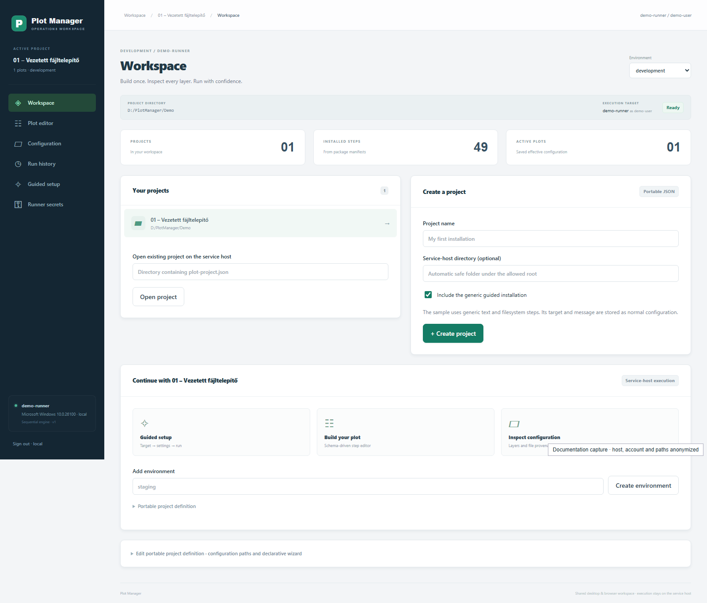
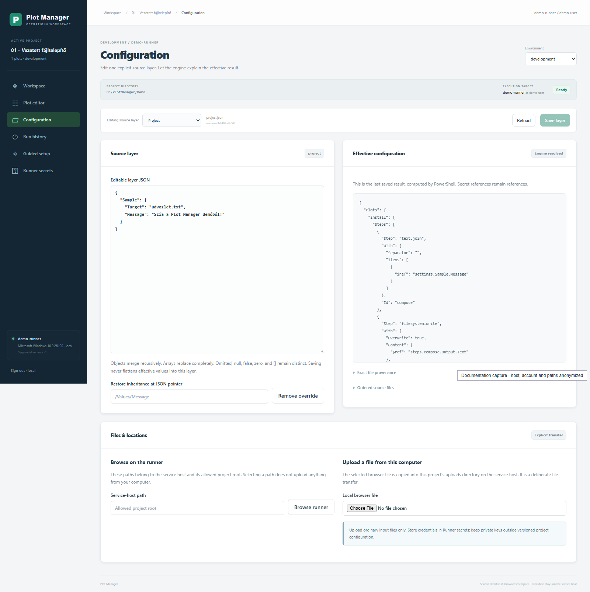
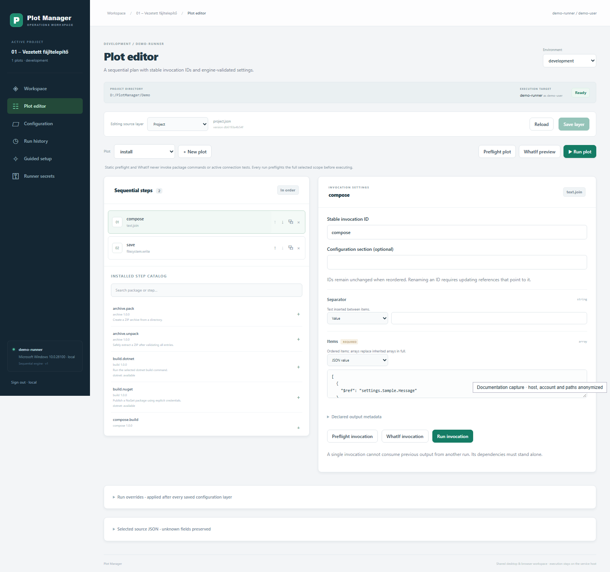
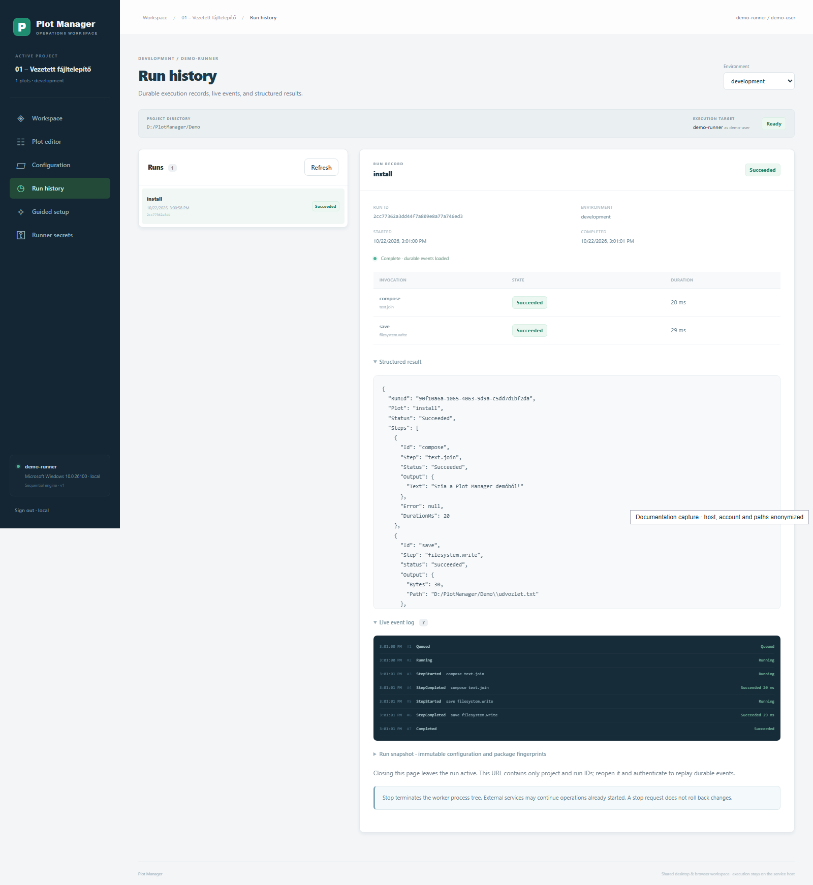
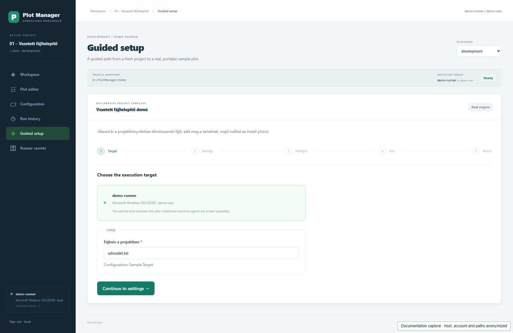
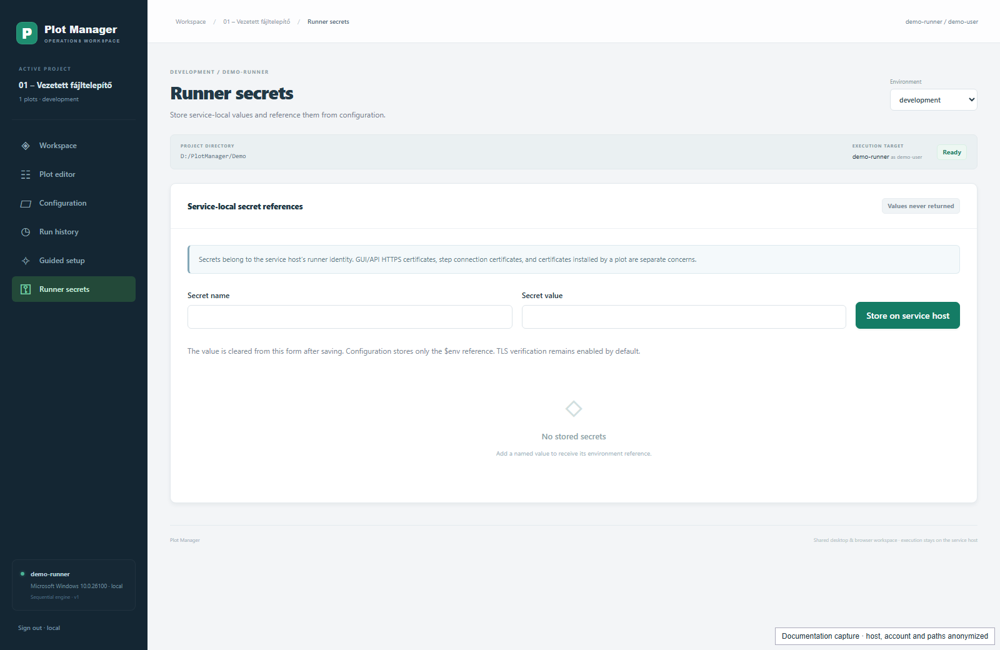

<!-- documentation-anchors:start -->
<a id="doc-plot-manager--complete-user-guide"></a>
<!-- documentation-anchors:end -->
# Plot Manager – teljes felhasználói útmutató

<!-- documentation-navigation -->
[English](management-user-guide.md) | [Magyar](management-user-guide-hu.md) · [Dokumentáció](README-hu.md) · [Projekt](../README-hu.md)
<!-- /documentation-navigation -->

Ez az útmutató a jelenlegi asztali és böngészős Plot Manager felületét mutatja be. Az angol feliratokat pontosan úgy írjuk, ahogy a GUI-ban szerepelnek; utánuk magyarul olvasható a jelentésük és a hatásuk. Az oldalak leírása a GitHubon, a helyi gép és futó alkalmazás nélkül is követhető.

A négy elkészített projekt részletes, lépésenkénti bemutatója a [Demóprojektek és forgatókönyvek](management-demo-projects-hu.md) dokumentumban található. A `04 – SenseNet Docker telepítés és menedzsment` projekt külön [telepítési és üzemeltetési leírást](../examples/sensenet-docker/README-hu.md) is kapott.

A szerkesztési állapot megőrzésének alább leírt javításai a `codex/management-editing-safety` forráság részei. A korábban átadott, `a8cb561b` buildből készült telepítők még a javítás előtti felületet tartalmazzák. A forrás és a csomagok ellenőrzését az [ellenőrzési eredmények](management-validation-hu.md#doc-editing-safety-follow-up) különválasztják.

<!-- documentation-anchors:start -->
<a id="doc-contents"></a>
<!-- documentation-anchors:end -->
## Tartalom

1. [Mit jelent a projekt, a plot és a lépés?](#doc-1-what-are-projects-plots-and-steps)
2. [Hol fut, hol tárol, mi történik bezáráskor?](#doc-2-where-does-it-run-and-store-data-and-what-happens-when-it-closes)
3. [Belépés és a képernyő felépítése](#doc-3-signing-in-and-the-screen-layout)
4. [Workspace – projektek és környezetek](#doc-4-workspace--projects-and-environments)
5. [Configuration – forrásrétegek és öröklés](#doc-5-configuration--source-layers-and-inheritance)
6. [Plot editor – lépések összeállítása](#doc-6-plot-editor--composing-steps)
7. [Ellenőrzés, előnézet és tényleges futtatás](#doc-7-validation-preview-and-actual-execution)
8. [Run history – eredmények, napló és leállítás](#doc-8-run-history--results-logs-and-stopping)
9. [Guided setup – vezetett beállítás](#doc-9-guided-setup--guided-configuration)
10. [Runner secrets – titkok kezelése](#doc-10-runner-secrets--managing-secrets)
11. [Teljes munkafolyamatok](#doc-11-complete-workflows)
12. [Hibák és gyakori kérdések](#doc-12-errors-and-frequently-asked-questions)
13. [Jelenlegi határok és további dokumentáció](#doc-13-current-limits-and-further-documentation)

<!-- documentation-anchors:start -->
<a id="doc-1-what-are-projects-plots-and-steps"></a>
<!-- documentation-anchors:end -->
## 1. Mit jelent a projekt, a plot és a lépés?

| Fogalom | Jelentése | Példa |
| --- | --- | --- |
| **Workspace** | Az adott Plot Manager szolgáltatásban az adott felhasználóhoz felvett projektek listája. | A négy demó megjelenése a nyitóoldalon. |
| **Project / projekt** | Egy könyvtár, benne a hordozható projektleírással, konfigurációkkal és esetleges bemeneti fájlokkal, segédprogramokkal. | A SenseNet Docker projekt saját `compose.yaml` fájllal. |
| **Plot** | Névvel ellátott, sorrendben végrehajtandó műveletsor. Egy projektben több plot lehet. | `install`, `status`, `backup`. |
| **Step / lépésdefiníció** | Egy telepített csomag újrahasználható művelete, megadott paraméterekkel és eredménnyel. | `text.join`, `filesystem.write`, `compose.up`. |
| **Invocation / lépéspéldány** | Egy konkrét lépéshívás a plotban, saját stabil azonosítóval és paraméterekkel. | A `save` azonosítójú `filesystem.write` hívás. |
| **Environment / környezet** | Egy választott konfigurációs réteg, amely például a fejlesztői fájlnevet vagy portot felülírja. | `development`, `production`; a név önmagában nem jelent éles rendszert. |
| **Runner / végrehajtó** | A Plot Manager szolgáltatást futtató gép és operációsrendszer-felhasználó. | A bal alsó kártyán és a felső sávban látható gép/identitás. |
| **Run / futás** | Egy mentett plot konkrét elindítása, önálló futásazonosítóval, állapottal és tartós eredménnyel. | Ugyanazt az `install` plotot kétszer indítva két futás keletkezik. |
| **Preflight** | A motor statikus ellenőrzése a tényleges csomagműveletek meghívása előtt. | Érvényes-e a paraméter, létezik-e a lépés, megfelelő-e a függőségek sorrendje? |

A plot lineáris: az első lépés után a második, majd a harmadik következik. Egy korábbi lépés kimenete lehet egy későbbi bemenete. A GUI ugyanazt a PowerShell-motort használja, amely a natív parancssori futtatást is végzi.

<!-- documentation-anchors:start -->
<a id="doc-2-where-does-it-run-and-store-data-and-what-happens-when-it-closes"></a>
<!-- documentation-anchors:end -->
## 2. Hol fut, hol tárol, mi történik bezáráskor?

<!-- documentation-anchors:start -->
<a id="doc-the-browser-is-the-interface-the-service-does-the-work"></a>
<!-- documentation-anchors:end -->
### A böngésző a kezelőfelület; a szolgáltatás végzi a munkát

```text
Asztali ablak vagy böngésző
          │ konfiguráció, indítás, eredmény megjelenítése
          ▼
Plot Manager szolgáltatás a megjelenített gépen
          │ a megjelenített operációsrendszer-felhasználó jogaival
          ▼
PowerShell-motor → fájlok / Docker / HTTP / más telepített csomagok
```

Ez értelmező ábra, nem képernyőkép. A **PROJECT DIRECTORY** a szolgáltatás gépén található könyvtár. Az **EXECUTION TARGET** mutatja, melyik gép és felhasználó végez műveleteket. Egy távoli szerverhez kapcsolódó böngészőben a `localhost`, a Docker és a fájlútvonalak a végrehajtó szempontjából értendők, ha az adott lépés nem határoz meg más célt.

Ugyanaz a React-alkalmazás fut az asztali ablakban és a böngészőben, és kizárólag a saját ASP.NET-szolgáltatásához kapcsolódik. Az **Environment** választó konfigurációt vált; nem választ másik végrehajtó gépet. A jelenlegi GUI egy szolgáltatás saját végrehajtóját használja. Több távoli agent kiválasztására még nincs kezelőfelület.

<!-- documentation-anchors:start -->
<a id="doc-storage-locations-and-format"></a>
<!-- documentation-anchors:end -->
### Tárolási helyek és formátum

Az alábbiak a normál indítók alapértékei Windowson. Az üzemeltető más adattárat és engedélyezett projektgyökeret is megadhat.

| Indítás | Alapértelmezett adattár | Alapértelmezett projektgyökér |
| --- | --- | --- |
| Telepített asztali alkalmazás | `%LOCALAPPDATA%\io.github.vargajoe.plotmanager` | Az adattár `projects` alkönyvtára. |
| `Start-Management.ps1` böngészős indító | `%LOCALAPPDATA%\PlotManager\browser` | Az adattár `projects` alkönyvtára. |
| Közvetlenül indított vagy hosted szolgáltatás | Az üzemeltető `PLOTMANAGER_DATA` beállítása; közvetlen indításkor a szolgáltatás alapértéke `%LOCALAPPDATA%\PlotManager`. | `PLOTMANAGER_PROJECT_ROOT`, ennek hiányában az adattár `projects` könyvtára. |

Linuxon a megfelelő felhasználói alkalmazásadat-könyvtár használatos; a tényleges projektútvonal mindig a GUI-ban ellenőrizhető. Az asztali indító projektgyökere a `PLOTMANAGER_DESKTOP_PROJECT_ROOT` helyi indítási beállítással módosítható; részletek a [telepítési leírásban](management-deployment-hu.md#doc-native-desktop).

A program telepítési könyvtára a programfájlok helye. A beállításokat a projekt kiválasztott JSON-fájljai tartalmazzák; a szolgáltatás adattárában van a projektregiszter, a futási előzmény és a helyi titoktár. A forráskód checkoutjából nem vesz fel automatikusan projekteket.

Egy hordozható projekt tipikus szerkezete:

```text
projekt/
├── plot-project.json             # név, konfigurációfájlok, opcionális wizard
├── default.json                  # közös alapértékek és plotok
├── project.json                  # projekt saját felülírásai
├── environments/
│   └── development.json          # környezeti felülírás
├── uploads/                     # GUI-val szándékosan feltöltött fájlok
└── ...                          # a projekt saját fájljai és eredményei
```

A `default.json` és `project.json` elnevezés bevett minta, nem kötelező fájlnév: a `plot-project.json` relatív útvonalai határozzák meg a használt fájlokat. A konfiguráció a natív motor meglévő JSON-formátuma marad. A `plot-project.json` ehhez ad hordozható GUI-projektleírást; a GUI nem alakítja a rétegeket egy új, összelapított beállításfájllá. A történelmi `-Legacy` konfiguráció külön kompatibilitási út, lásd [a régi formátum leírását](legacy/settings-hu.md).

Ha a desktop és a böngészős példány saját adattárában is van ugyanolyan nevű demó, azok külön másolatok. Egyikben végzett módosítás nem szinkronizálódik automatikusan a másikba. Másoláskor a teljes projektet vidd át, de a helyi titkokat, futási adattárat és például a SenseNet generált `.local` könyvtárát ne kezeld megosztható forrásként.

<!-- documentation-anchors:start -->
<a id="doc-closing-signing-out-and-shutting-down-the-machine"></a>
<!-- documentation-anchors:end -->
### Bezárás, kijelentkezés, gépleállítás

| Művelet | Hatás |
| --- | --- |
| Böngészőfül bezárása | A szolgáltatás és a futás tovább működhet. A mentetlen szerkesztés elveszhet. |
| **Sign out** | Kijelentkezik a GUI-ból; nem futásleállító gomb. |
| A böngészős indítóterminál vagy szolgáltatás leállítása | A szolgáltatás saját futtatófolyamatait is leállítja. |
| Az asztali ablak bezárása | Megerősítést kér: **Close and stop** leállítja a saját helyi szolgáltatást és workereket; **Keep open** nyitva hagyja az alkalmazást. |
| A gép kikapcsolása | A helyi szolgáltatás és folyamatai leállnak. A mentett fájlok és futási rekordok megmaradnak. A már elindított külső műveletek sorsát külön ellenőrizni kell. |

Egy korábban elindított Docker-konténer külön életciklussal rendelkezik; a GUI bezárása nem azonos a projekt `stop` plotjával. Ha azt akarod, hogy a SenseNet stack álljon le, a projekt erre szolgáló plotját futtasd. A futás megszakítása nem állítja vissza az addig végzett módosításokat.

<!-- documentation-anchors:start -->
<a id="doc-3-signing-in-and-the-screen-layout"></a>
<!-- documentation-anchors:end -->
## 3. Belépés és a képernyő felépítése

<!-- documentation-anchors:start -->
<a id="doc-signing-in"></a>
<!-- documentation-anchors:end -->
### Belépés

A normál helyi indító és az asztali alkalmazás előkészíti a saját hitelesített kapcsolatát. Ha a belépőoldal jelenik meg, az **Access token** mezőbe a szolgáltatáshoz kapott operátori tokent kell beírni, majd **Connect to workspace**.

Ez a Plot Manager belépése; nem a SenseNet `admin` jelszava, nem Docker Hub-jelszó, és nem a **Runner secrets** egyik értéke. A felület a tokent HttpOnly munkamenetsütire cseréli. A frontend nem menti böngésző `localStorage` vagy `sessionStorage` tárba, illetve projektfájlba. A helyi indító belépési URL-jének egyszer használatos, tokent tartalmazó részét még a cserét megelőzően azonnal eltávolítja a címből. A kijelentkezés visszavonja a böngésző munkamenetsütijét.

<!-- documentation-anchors:start -->
<a id="doc-layout-map"></a>
<!-- documentation-anchors:end -->
### Elrendezési térkép

Az ábra a közös szerkezetet szemlélteti, nem egy adott képernyő pontos méretezését.

```text
┌──────────────────────┬──────────────────────────────────────────────────────┐
│ Plot Manager         │ Workspace / projekt neve / aktuális oldal  identity  │
│ ACTIVE PROJECT       ├──────────────────────────────────────────────────────┤
│ projekt, plotszám     │ Oldalcím                          Environment [▼]     │
│                      │ Hiba / siker / mentetlen változás jelzése             │
│ Workspace            │ PROJECT DIRECTORY     EXECUTION TARGET     [Ready]    │
│ Plot editor          ├──────────────────────────────────────────────────────┤
│ Configuration        │ Az oldal saját eszköztára és paneljei                 │
│ Run history          │                                                      │
│ Guided setup         │ Például Plot editor:                                 │
│ Runner secrets       │ [lépések + katalógus]   [kijelölt lépés paraméterei]    │
│                      │                                                      │
│ runner gép / OS       │ Például Configuration:                               │
│ mód / protokoll       │ [szerkesztett forrás]   [mentett effektív konfiguráció]│
│ Sign out             │                                                      │
└──────────────────────┴──────────────────────────────────────────────────────┘
```

| Közös elem | Mit mutat vagy csinál? |
| --- | --- |
| **Plot Manager** embléma | Visszavisz a **Workspace** oldalra. |
| **ACTIVE PROJECT** | Az aktuálisan kiválasztott projekt, az elérhető plotok száma és a környezet. |
| Bal oldali hat navigációs gomb | A következő fejezetekben leírt oldalakat nyitja meg. Projekt nélkül csak a **Workspace** és **Runner secrets** használható. |
| Felső útvonaljelző | Az aktuális projektet és oldalt mutatja. |
| Felső gépidentitás, bal alsó runner-kártya | A végrehajtó tényleges gépe, OS-e, `local`/`hosted` módja, operációsrendszer-identitása és protokollja. |
| **Environment** | A már deklarált környezetek közül választ. **Project layers only**: a default- és projektréteget használja, környezeti réteg nélkül. |
| **PROJECT DIRECTORY** | A kiválasztott projekt abszolút könyvtára a szolgáltatás gépén. |
| **EXECUTION TARGET** | A szolgáltatás gépe és a tényleges végrehajtási felhasználó. |
| **Ready / Running** jelvény | Van-e aktív, zárolást tartó futás ebben a projektben. A `Ready` nem a Docker-stack vagy más külső alkalmazás egészségvizsgálata. |
| Hiba/siker üzenet **×** gombja | Csak az üzenetet zárja be; nem vonja vissza a műveletet. |
| **Unsaved changes** figyelmeztetés | A kijelölt konfigurációs rétegnek van még el nem mentett vázlata. **Save selected layer** ugyanazt a réteget menti, mint a szerkesztő **Save layer** gombja. |
| **Unsaved project definition changes** figyelmeztetés / **Open project definition** | A hordozható projektleírás külön vázlatát még nem mentetted. A gomb visszavisz a **Workspace** definíciós paneljéhez, ahol mentheted vagy újratöltheted. |
| **Unapplied parameter edits** figyelmeztetés | Valamelyik paraméter beírt szövege még nem érvényesült. A mentés és futtatás tiltott, amíg kijavítod vagy megerősítetten eldobod. |
| Folyamatban lévő művelet miatti tiltások | A GUI nem enged újabb ütköző műveletet vagy futás közbeni rétegírást. A futás a **Run history** oldalon követhető. |
| **Sign out · …** | Kijelentkezik az aktuális operátori munkamenetből. |
| Lenyitható sorok, JSON-panelek | A címre kattintva nyílnak/csukódnak. A megjelenítő JSON-panel olvasható eredmény, a szövegmezős JSON-szerkesztő módosítható forrás. |

<!-- documentation-anchors:start -->
<a id="doc-4-workspace--projects-and-environments"></a>
<!-- documentation-anchors:end -->
## 4. Workspace – projektek és környezetek



*Valódi felület az 01-es demóval; a gép-, fiók- és könyvtáradatok anonimizáltak.*

<!-- documentation-anchors:start -->
<a id="doc-statistics-and-project-selection"></a>
<!-- documentation-anchors:end -->
### Statisztikák és projektválasztás

| Panel/vezérlő | Használat |
| --- | --- |
| **PROJECTS** | Az aktuális operátor számára regisztrált projektek száma. |
| **INSTALLED STEPS** | A szolgáltatásban telepített lépéskatalógus mérete. |
| **ACTIVE PLOTS** | A kijelölt projekt mentett, összeállított konfigurációjában lévő plotok száma. |
| **Your projects** | Projektkártyák névvel és tényleges könyvtárral. A kártyára kattintás kiválasztja a projektet. |
| **Open existing project on the service host** | Egy már létező, `plot-project.json`-t tartalmazó runneroldali könyvtárat kell megadni. |
| **Open project** | Felveszi/megnyitja ezt a meglévő projektet a workspace-ben. Nem tölt fel könyvtárat a saját böngészőgépedről. |

Az útvonalnak a szolgáltatás engedélyezett projektgyökerén belül kell lennie. Az ismeretlen, másik felhasználóhoz tartozó, nem engedélyezett vagy nem biztonságosan feloldható útvonalat a szolgáltatás visszautasítja. A projekttulajdonlást az API ellenőrzi.

<!-- documentation-anchors:start -->
<a id="doc-new-project"></a>
<!-- documentation-anchors:end -->
### Új projekt

| Mező/gomb | Használat |
| --- | --- |
| **Project name** | Az új projekt megjelenítési neve, legfeljebb 120 karakter. |
| **Service-host directory (optional)** | Új vagy üres könyvtár a végrehajtó gépen. Üresen hagyva a szolgáltatás az engedélyezett gyökér alatt hoz létre saját mappát. |
| **Include the generic guided installation** | Bejelölve az általános szöveg/fájlrendszer mintát és hozzá vezetett űrlapot készíti el. Nem SenseNet-telepítőt generál. |
| **+ Create project** | Létrehozza a projektet és a rétegfájlokat; mintával létrehozva rögtön a **Guided setup** oldalra lép. Nem üres, már létező projekt megnyitásához az **Open project** kell. |

<!-- documentation-anchors:start -->
<a id="doc-continue-with--panel"></a>
<!-- documentation-anchors:end -->
### Continue with … panel

| Vezérlő | Cél |
| --- | --- |
| **Guided setup** | A projekt deklarált vezetett űrlapja. |
| **Build your plot** | A **Plot editor** oldal. |
| **Inspect configuration** | A **Configuration** oldal. |
| **Add environment** mező | Új környezet neve: 1–64 betű, szám, `_` vagy `-`, például `staging`. |
| **Create environment** | Új környezeti JSON-fájlt és hozzá projektleírás-bejegyzést hoz létre, majd kiválasztja. Nem telepít külön alkalmazást vagy infrastruktúrát. |
| **Portable project definition** | A regisztrált projekt hordozható leírásának olvasható JSON-nézete. |

<!-- documentation-anchors:start -->
<a id="doc-edit-portable-project-definition-"></a>
<!-- documentation-anchors:end -->
### Edit portable project definition …

Ez a lenyitható, haladó panel a `plot-project.json` fájlt szerkeszti. A **Portable project definition JSON** mezőben a név, a konfigurációfájlok relatív útvonalai, a környezetek és a `wizard` leírója látható.

- **Reload definition**: a legfrissebb projektleírást tölti be; helyi módosítás eldobása előtt megerősítést kér.
- **Save definition**: verzióellenőrzéssel menti a leírást és frissíti a kapcsolódó projektadatokat. Futás vagy mentetlen konfigurációs réteg mellett tiltott.

Ez külön mentés a **Save layer** gombtól. A projektleírás vázlata megmarad a GUI oldalai közötti váltáskor; projektváltáskor az eldobásához megerősítés kell, és az ablak/böngésző bezárása is figyelmeztethet a mentetlen definícióra. A **Save definition** sikeres mentése megszünteti a definíció saját mentetlen állapotát. Ismeretlen érvényes metaadatok megmaradnak. A szolgáltatás ellenőrzi a formátumverziót, a fájlútvonalakat és a wizard kötéseit. A fájl nem titoktár.

Minimális hordozható leírás:

```json
{
  "formatVersion": 1,
  "name": "Saját példa",
  "configuration": {
    "default": "default.json",
    "project": "project.json",
    "environments": {
      "development": "environments/development.json"
    }
  }
}
```

<!-- documentation-anchors:start -->
<a id="doc-5-configuration--source-layers-and-inheritance"></a>
<!-- documentation-anchors:end -->
## 5. Configuration – forrásrétegek és öröklés



*Valódi felület az 01-es demóval; a gép-, fiók- és könyvtáradatok anonimizáltak.*

<!-- documentation-anchors:start -->
<a id="doc-the-top-editing-toolbar"></a>
<!-- documentation-anchors:end -->
### A felső szerkesztőeszköztár

Ez a sáv a **Configuration** és a **Plot editor** oldalon is megjelenik.

| Vezérlő | Hatás |
| --- | --- |
| **Editing source layer** | Kiválasztja, melyik konkrét forrásfájlt szerkeszted: default, project vagy a választott environment rétegét. |
| Mellette látható útvonal és **version …** | Az eredeti rétegfájl és a legutóbb beolvasott verzió rövid azonosítója. |
| **Reload** | Újraolvassa a réteget és az effektív konfigurációt. Mentetlen vázlat esetén eldobási megerősítést kér. |
| **Save layer** | Csak a kijelölt forrásfájlt menti, majd a motorral újraszámíttatja az effektív konfigurációt. Érvénytelen JSON, aktív futás vagy hiányzó módosítás esetén tiltott. |

**Az Environment és az Editing source layer két külön választás.** Például `development` környezetben szerkesztheted a default réteget is; az eredményben a projektréteg vagy development réteg továbbra is felülírhatja az adott értéket.

<!-- documentation-anchors:start -->
<a id="doc-source-and-effective-configuration"></a>
<!-- documentation-anchors:end -->
### Forrás és effektív konfiguráció

| Panel/lenyitható rész | Mit jelent? |
| --- | --- |
| **Source layer / Editable layer JSON** | A kiválasztott egyetlen JSON-fájl szerkeszthető tartalma. A gyökérnek JSON-objektumnak kell lennie. |
| **Effective configuration / Engine resolved** | A mentett fájlokból a PowerShell-motor által összeállított konfiguráció. Nem a bal oldali mentetlen szöveg élő előnézete. A hivatkozások itt még szerepelhetnek hivatkozásként; egy lépés végső paramétereit a preflight mutatja. |
| **Exact file provenance** | Megmutatja, melyik konfigurációs útvonal nyertes értéke melyik forrásfájlból származik. |
| **Ordered source files** | A motor által beolvasott fájlok és sorrendjük. |
| **Restore inheritance at JSON pointer** | A kiválasztott rétegből egy konkrét felülírást távolít el. |
| **Remove override** | A megadott objektumtulajdonságot a szerkesztési vázlatból törli; utána **Save layer** szükséges. |

<!-- documentation-anchors:start -->
<a id="doc-two-successive-orders"></a>
<!-- documentation-anchors:end -->
### Két egymásra épülő sorrend

Először a konfigurációfájlok állnak össze:

```text
default fájl → projektfájl → kiválasztott környezeti fájl
            a későbbi réteg azonos helyen felülírja a korábbit
```

Ezután egy adott lépéspéldány paraméterei kapnak értéket. Az alábbi listában a későbbi elem erősebb:

1. A lépés paramétersémájának saját alapértékei.
2. Konfigurációs `Defaults`.
3. A konkrét lépés `StepDefaults["package.step"]` beállításai.
4. A lépéspéldány által választott felső szintű `Section`.
5. A plot saját `Defaults` beállításai.
6. A lépéspéldány `With` paraméterei.
7. Az adott futásra megadott, lépéspéldány-azonosítóval címzett run override-ok.

Ezért egy általános defaultérték megváltoztatása nem ír felül automatikusan egy lépés `With` mezőjében már konkrétan megadott értéket. Vegyes paraméterű lépésekhez ne adj minden lépésre értelmezhetetlen paramétert a globális `Defaults` objektumba; használj `StepDefaults`-ot vagy konkrét `With` mezőt.

<!-- documentation-anchors:start -->
<a id="doc-inheritance-rules-with-an-example"></a>
<!-- documentation-anchors:end -->
### Öröklési szabályok, példával

| Forrásbeli érték | Jelentés |
| --- | --- |
| Hiányzó tulajdonság | Örökli a korábbi réteg értékét. |
| Objektum | A tulajdonságai rekurzívan egyesülnek. |
| Tömb, például `["a"]` | A korábbi teljes tömböt lecseréli. |
| Üres tömb `[]` | Tudatosan üres tömb; nem „örökölt”. |
| `null` | Kifejezett null érték; a felhasználó paraméterének engednie kell. |
| `false`, `0`, `""` | Valódi értékek, nem hiányzó beállítások. |

Példa három külön fájlra:

`default.json`:

```json
{"Values":{"Message":"Alap","Enabled":true,"Items":["a","b"]}}
```

`project.json`:

```json
{"Values":{"Message":"Projekt","Enabled":false}}
```

`environments/development.json`:

```json
{"Values":{"Message":"Fejlesztői","Items":[]}}
```

A `development` effektív értéke: `Message = "Fejlesztői"`, `Enabled = false`, `Items = []`. **Project layers only** mellett: `Message = "Projekt"`, `Enabled = false`, `Items = ["a","b"]`.

Ha a projektrétegben a `Values.Message` felülírást akarod megszüntetni, válaszd a project réteget, add meg a `/Values/Message` pointert, kattints **Remove override**, majd **Save layer**. Egy kulcsban lévő `/` jelet `~1`, a `~` jelet `~0` alakban kell a pointerbe írni. A helper objektumtulajdonságot töröl; egy tömb öröklésének visszaállításához a teljes tömbtulajdonságot távolítsd el.

A mentés nem írja vissza az összeállított jobb oldali objektumot a bal oldali rétegbe. Az ismeretlen érvényes mezők és a forrásban használt kulcsírásmód megmaradnak, a natív kisbetűs `plots`, `steps` és paraméternevek is, amikor ismert mezőket vizuálisan szerkesztesz. A forrás JSON-szerkesztő pontosságot megőrző feldolgozást és sorosítást használ: az ismeretlen nagy egészek, pontos tizedes literálok és a JavaScript véges számtartományán túli számok más mezők szerkesztése és mentése közben is számliterálok maradnak. A biztonságos API-számlálók közönséges számok maradnak. A nem biztonságosan ábrázolható numerikus paramétert a JSON-érték mezőben szerkeszd; a paramétertípus támogatásáról továbbra is a natív motor dönt. A motor effektív nézete a saját számtípusait használja, és eltérő pontosságú lehet, ezért az olvasható effektív nézetet ne másold vissza egy teljes forrásréteg helyére.

<!-- documentation-anchors:start -->
<a id="doc-save-conflicts-and-unsaved-changes"></a>
<!-- documentation-anchors:end -->
### Mentési ütközés és mentetlen változás

Minden mentés a beolvasott fájlverzióra hivatkozik. Ha ugyanazt a fájlt másik ablak, operátor vagy külső szerkesztő megváltoztatta, a szolgáltatás `409`/`changed` üzenettel visszautasítja a felülírást. Másold ki a saját vázlatod szükséges részét, **Reload**, hasonlítsd össze a friss tartalmat, és alkalmazd újra a saját módosításodat.

Projekt-, környezet- vagy forrásréteg-váltáskor a GUI rákérdez a módosított konfigurációs vázlat eldobására. A böngésző bezárása is figyelmeztethet a mentetlen rétegre, definícióra vagy nem alkalmazott paraméterbevitelre. A preflight és a futás mentett fájlokból dolgozik: előbb rendezd a mezőhibákat és ments, aztán ellenőrizz/futtass.

<!-- documentation-anchors:start -->
<a id="doc-files--locations--files-and-paths"></a>
<!-- documentation-anchors:end -->
### Files & locations – fájlok és útvonalak

Ez a panel a **Configuration** oldal alján található.

| Vezérlő/panel | Működés |
| --- | --- |
| **Browse on the runner** | A szolgáltatás gépén lévő helyeket listázza, az engedélyezett projektgyökéren belül. |
| **Service-host path** | Itt adható meg a runneroldali útvonal. Üres mezőből a gyökér kérhető le. |
| **Browse runner** | Lekéri az adott könyvtár listáját. Az **Allowed root** megmutatja a megengedett gyökeret. |
| Könyvtár neve a listában | Megnyitja/listázza a könyvtárat. |
| Fájl neve a listában | Beírja az útvonalát a mezőbe. Nem tölti le, nem szerkeszti és nem adja hozzá automatikusan egy lépéshez. |
| **Upload a file from this computer / Local browser file** | A böngésző fájlválasztójával kiválasztott fájlt ténylegesen átmásolja a szolgáltatás adott projektjének `uploads/` könyvtárába. |
| **Transferring file…** | A feltöltés folyamatban van. A sikerüzenet a létrejött relatív útvonalat adja vissza. |

A feltöltés egy fájlt másol, legfeljebb 10 MiB méretben, egyedi fájlnévvel. A visszakapott például `uploads/…-input.json` útvonalat neked kell a megfelelő konfigurációs paraméterbe tenni. Titkot vagy privát kulcsot ne ezzel a mintafájl-feltöltéssel kezelj; a titkokhoz a **Runner secrets** való.

<!-- documentation-anchors:start -->
<a id="doc-6-plot-editor--composing-steps"></a>
<!-- documentation-anchors:end -->
## 6. Plot editor – lépések összeállítása



*Valódi felület az 01-es demóval; a gép-, fiók- és könyvtáradatok anonimizáltak.*

<!-- documentation-anchors:start -->
<a id="doc-plot-selector-and-the-two-main-panels"></a>
<!-- documentation-anchors:end -->
### Plotválasztó és a két fő panel

| Elem | Működés |
| --- | --- |
| **Plot** választó | A mentett konfigurációban és az aktuális vázlatban lévő plotok közül választ. |
| **+ New plot** | Nevet kér, és az aktuális forrásréteg vázlatában üres plotot készít. Azonos nevű plot még egyszer nem hozható létre. Utána lépések hozzáadása és **Save layer** következik. |
| **Sequential steps / In order** | A kiválasztott plot végrehajtási sorrendje. A sorszám a sorrendet, a nagyobb felirat az invocation ID-t, a kisebb a lépésdefiníciót mutatja. |
| Lépéssorra kattintás | A jobb oldali **INVOCATION SETTINGS** panelen ennek a konkrét példánynak a paramétereit mutatja. |
| **Installed step catalog** | A szolgáltatásba telepített csomagokból származó műveletek. A kereső ID és leírás alapján szűr. |
| Katalógus **+** / lépéskártya | A művelet új példányát a plot végére teszi, új stabil ID-val és kezdetben üres `With` objektummal. |

A katalógus mutatja a csomagnevet, verziót, leírást, platformkorlátozást, szükséges külső eszközöket, valamint `available`/`missing on runner` állapotukat. Az **Unsupported** lépés nem adható hozzá az adott platformon. A Docker, Git vagy más külső eszköz tényleges elérhetőségét a runner gépén kell megoldani; a böngésző saját gépén telepített program ettől még nem lesz elérhető a szerveren.

<!-- documentation-anchors:start -->
<a id="doc-step-row-buttons"></a>
<!-- documentation-anchors:end -->
### Lépéssor gombjai

| Gomb | Hatás |
| --- | --- |
| **↑** / **Move … earlier** | Egy pozícióval előrébb teszi az adott példányt. Az elsőnél tiltott. |
| **↓** / **Move … later** | Egy pozícióval hátrébb teszi. Az utolsónál tiltott. |
| **⧉** / **Copy …** | Másolatot tesz közvetlenül utána, új ID-val. A paraméterek is másolódnak. |
| **×** / **Remove …** | Eltávolítja a példányt a vázlatból. A módosítást a **Save layer** teszi tartóssá. |

Átrendezéskor az ID változatlan. Másoláskor a másolt hivatkozások eredeti céljai megmaradnak; nézd át, valóban arra kell-e hivatkozniuk. Ha törölsz vagy átnevezel egy producerlépést, a rá mutató hivatkozásokat külön kell javítani. Mentés után ismét futtass preflightot.

Ha egy korábbi rétegből örökölt plot lépéseit módosítod, a kiválasztott rétegben a plot **teljes lépéstömbjének** felülírása jön létre. A tömböt későbbi réteg nem elemenként toldja meg. A szerkesztő a tömböt a motor eredetinformációja által azonosított pontos nyers forrásfájlból olvassa, és megőrzi az eredeti lépéshívás-metaadatokat. A plot egyéb, nem felülírt tulajdonságai öröklődhetnek a kiválasztott rétegbe másolás helyett; a kiválasztott plotobjektumban már meglévő tulajdonságok megmaradnak.

<!-- documentation-anchors:start -->
<a id="doc-invocation-settings--the-step-occurrences-parameters"></a>
<!-- documentation-anchors:end -->
### INVOCATION SETTINGS – a lépéspéldány paraméterei

| Mező/rész | Jelentés |
| --- | --- |
| **Stable invocation ID** | Egyedi azonosító a ploton belül. Betűvel indulhat, utána betű, szám, `_`, `-` lehet. A rá hivatkozó lépéseket átnevezés után külön módosítani kell. |
| **Configuration section (optional)** | A konfiguráció felső szintű szekcióját választja a natív `Section` szabály szerint. Nem új fájlútvonal és nem munkakönyvtár. |
| Sémából generált paramétermezők | A telepített lépés által elfogadott paraméterek, típusok, kötelezőség, leírás és esetleges választási tartomány. |
| **Declared output metadata** | A lépés deklarált kimeneti mezői. Ez a lehetséges kimenet leírása; konkrét eredmény csak futáskor születik. |
| Ismeretlen lépésre figyelmeztető üzenet | A konfiguráció olyan lépésre hivatkozik, amely nincs a telepített katalógusban. JSON-ból megvizsgálható, de a motor nem futtatja elérhető lépésként. |

Egy paraméternél nemcsak az értéket, hanem annak forrását is kiválasztod:

| Paraméterforrás felirata | JSON / hatás |
| --- | --- |
| **Inherited / omitted** | Ebből a példányból elhagyja a paramétert; az erősebb/gyengébb beállítások szabályai alapján a motor öröklött vagy alapértéket keres. Ez nem az egész konfigurációfájl tulajdonságának törlése. |
| **Value** | Közvetlen érték. Boolnál `false`/`true` választó, egész számnál számmező, `ValidateSet` esetén megengedett értéklista. |
| **JSON value** | Tömb, objektum vagy más érvényes JSON-érték. Csak akkor kerül a vázlatba, ha érvényes, és elhagyod a mezőt. |
| **Settings / output reference** | `{"$ref":"…"}`: konfigurációértékre vagy egy korábbi lépéspéldány kimenetére hivatkozik. A mező javaslatokat is kínál. |
| **Runner environment / secret** | `{"$env":"…"}`: a runner környezeti változójának vagy a titoktár által adott változónak a **nevét** kéri, nem a titok értékét. |
| **Explicit null** | Kifejezett `null`, kizárólag ha a paraméterséma engedi. Nem öröklés. |

Titkosnak deklarált paraméternél a GUI nem kínál közvetlen `Value`/`JSON value` bevitelt. Használj titoktárból kapott `$env` hivatkozást, vagy megfelelő hivatkozási láncot; a szolgáltatás a közvetlen titokliterált visszautasítja.

**JSON-szerkesztésnél a mező elhagyása fontos.** Ha az `Unapplied JSON` vagy `Invalid JSON` üzenet látszik, a legutóbbi érvényes érték maradt a vázlatban, és a mentés, preflight, preview és futtatás tiltott. Javítsd a szöveget, kattints ki a mezőből, és csak ezután ments. Ugyanez a védelem érvényes egy kitörölt vagy hibás számértékre is. Ha másik lépésre vagy nézetre váltanál a még nem alkalmazott bevitellel, a GUI külön eldobási megerősítést kér; a visszautasítás megőrzi a szöveget. Az inline hibát nem helyettesíti a másik mezőben megnyomott mentés.

<!-- documentation-anchors:start -->
<a id="doc-references-with-a-concrete-example"></a>
<!-- documentation-anchors:end -->
### Hivatkozások, konkrét példa

```json
{"$ref":"settings.Values.Message"}
```

Ez a mentett, rétegekből összeállított konfiguráció `Values.Message` értékét használja.

```json
{"$ref":"steps.compose.Output.Text"}
```

Ez az ugyanabban a futásban **korábban** lefutott `compose` lépéspéldány `Text` kimenete. Nem egy korábbi futás eredménye és nem egy `compose` nevű csomag automatikus keresése.

```json
{"$env":"PLOTMANAGER_SECRET_EXAMPLE"}
```

Ez a runneren elérhető változó neve. A hivatkozásobjektum pontosan egy direktívát tartalmazzon. A `$ref` és `$env` nem PowerShell-kifejezés, és nem szövegbe behelyettesítendő sablon; például a `"prefix {$ref:...}"` nem ez a mechanizmus. A ponttal tagolt hivatkozási útvonal kulcsai maguk nem tartalmazhatnak pontot. A körkörös, hiányzó és előre mutató hivatkozás hibás. A kimenetjavaslatok csak korábbi invocation ID-ket kínálnak. A hivatkozások feloldását, a sémák ellenőrzését, a beállítások összeolvasztását és a műveletek végrehajtását a motor végzi; a GUI nem helyettesíti ezeket a natív szabályokat.

Az alábbi teljes plotban a második lépés az első eredményét írja fájlba:

```json
{
  "Values": {"Message": "Szia"},
  "Plots": {
    "hello": {
      "Steps": [
        {
          "Id": "compose",
          "Step": "text.join",
          "With": {
            "Items": [{"$ref":"settings.Values.Message"}, "Plot Manager"],
            "Separator": " – "
          }
        },
        {
          "Id": "save",
          "Step": "filesystem.write",
          "With": {
            "Path": "hello.txt",
            "Content": {"$ref":"steps.compose.Output.Text"},
            "Overwrite": true
          }
        }
      ]
    }
  }
}
```

A relatív `hello.txt` a projekt munkakönyvtárában jön létre. A példát saját demóprojektben használd: `Overwrite: true` mellett az ugyanott meglévő `hello.txt` felülíródik.

<!-- documentation-anchors:start -->
<a id="doc-additional-expandable-panels"></a>
<!-- documentation-anchors:end -->
### További lenyitható panelek

| Panel | Működés |
| --- | --- |
| **Run overrides · applied after every saved configuration layer** | Az adott futáskérésre szóló JSON-felülírások; a mező neve **Run overrides JSON, keyed by invocation ID**. Nem menti őket projektfájlba. |
| **Selected source JSON · unknown fields preserved** | A kiválasztott forrásréteg teljes, szerkeszthető JSON-ja. Ugyanaz a vázlat, mint a **Configuration** oldalon; itt a vizuális formán túli mezők is szerkeszthetők. |
| **Engine preflight** | Az utolsó sikeres statikus ellenőrzés eredménye; a következő fejezet részletezi. |

Például a fenti `save` lépés egyetlen futásban más célfájlt kap:

```json
{"save":{"Path":"hello-once.txt","Overwrite":true}}
```

Ez a felső szintű override-térkép a `save` **invocation ID** alapján címez, nem a `filesystem.write` lépésnév alapján. Titkot itt is hivatkozással adj meg. Projekt-/környezetváltáskor a GUI visszaállítja az override-mezőt; szükség esetén őrizd meg külön a nem titkos mintát.

<!-- documentation-anchors:start -->
<a id="doc-7-validation-preview-and-actual-execution"></a>
<!-- documentation-anchors:end -->
## 7. Ellenőrzés, előnézet és tényleges futtatás

Mentsd a kiválasztott réteget, ellenőrizd az **Environment**, **PROJECT DIRECTORY** és **EXECUTION TARGET** értékét, majd válassz műveletet.

| Gomb | Hatókör | Végez tényleges csomagműveletet? | Hol látszik az eredmény? |
| --- | --- | --- | --- |
| **Preflight plot** | A teljes kiválasztott plot. | Nem; statikus ellenőrzés. | **Engine preflight** panel a szerkesztőben. |
| **WhatIf preview** | A teljes plot. | Nem; a lépésparancsok kimaradnak. | Új tartós preview-futás a **Run history** oldalon. |
| **▶ Run plot** | A teljes plot sorrendben. | Igen. | **Run history**. |
| **Preflight invocation** | Csak a kijelölt példány. | Nem. | **Engine preflight**. |
| **WhatIf invocation** | Csak a kijelölt példány. | Nem. | Preview-futás a **Run history** oldalon. |
| **Run invocation** | Csak a kijelölt példány. | Igen. | **Run history**. |

**A preflight és a WhatIf nem teszteli aktívan a célrendszer kapcsolatát.** Egy sikeres preflight nem bizonyítja, hogy a Docker fut, hogy van jogosultság a célfájlra, hogy az adatbázis elérhető vagy egy szerver beléptet. A `http.*`, SQL-, Docker- vagy projektspecifikus ellenőrző lépést ténylegesen el kell indítani ahhoz, hogy annak kapcsolati eredményét lásd.

A statikus ellenőrzés a kiválasztott teljes hatókört ellenőrzi az első csomagművelet előtt: a lépés elérhetőségét, beállításait, kötelező paramétereit, statikus típusait, hivatkozásait és sorrendi függőségeit. A producer kimenetének tényleges mezője/típusa csak akkor ellenőrizhető véglegesen, amikor a producer már lefutott, közvetlenül a fogyasztó lépés végrehajtása előtt.

<!-- documentation-anchors:start -->
<a id="doc-engine-preflight-panel"></a>
<!-- documentation-anchors:end -->
### Engine preflight panel

Minden tervezett invocation külön lenyitható sor. A soron belül:

| Felirat | Jelentés |
| --- | --- |
| **Effective invocation settings** | A motor által meghatározott, végrehajtásra szánt paraméterek; a titkos értékek maszkolva. |
| **Setting layers** | Mely paraméterforrási szint adta az értéket, például sémaalapérték, `With`, override. |
| **Exact file / setting origins** | A konkrét forrásfájl, beállításútvonal és esetleges hivatkozási eredet. |
| **Complete plan response** | A teljes strukturált motorválasz. |

<!-- documentation-anchors:start -->
<a id="doc-why-cannot-a-dependent-step-run-on-its-own"></a>
<!-- documentation-anchors:end -->
### Miért nem futtatható önmagában egy függő lépés?

A fenti `hello` példában a `compose` önállóan futtatható. A `save` önállóan nem, mert szüksége van `steps.compose.Output.Text` értékére. A **Run invocation** nem indítja el automatikusan a korábbi lépéseket, és nem tölti be egy korábbi run kimenetét. Futtasd a teljes plotot, vagy készíts olyan külön plotot/példányt, amelynek minden bemenete önállóan rendelkezésre áll.

<!-- documentation-anchors:start -->
<a id="doc-consequences-of-starting-a-run"></a>
<!-- documentation-anchors:end -->
### Futás indításának következményei

Indításkor a szolgáltatás rögzíti a kiválasztott konfigurációfájlok és a motor/csomagok másolatát, valamint ezek verzióját és ujjlenyomatát. A hivatkozott futtatói környezetértékeket a kéréshez rögzíti; a titokértékek nem kerülnek a nyilvánosan olvasható konfigurációs snapshotba. A későbbi konfigurációs szerkesztés nem változtatja meg a már elindított futás bemenetét.

Egy aktív futás zárolja a projektet. Ugyanabban a projektben az ütköző második futás és a konfigurációmentés elutasításra kerül. A `Succeeded` preview azt jelenti, hogy az előnézeti futás sikeres; tényleges lépésműveleteket csak a `whatIf: false` futás végez.

<!-- documentation-anchors:start -->
<a id="doc-8-run-history--results-logs-and-stopping"></a>
<!-- documentation-anchors:end -->
## 8. Run history – eredmények, napló és leállítás



*Valódi felület az 01-es demóval; a gép-, fiók- és könyvtáradatok anonimizáltak.*

Az oldal bal oldala a futáslista, a jobb oldala a kijelölt futás részlete.

| Elem | Mit mutat/csinál? |
| --- | --- |
| **Runs** számláló | A projektben elérhető futási rekordok száma. |
| **Refresh** | Frissíti a listát, például egy másik ablakban indított futás megjelenítéséhez. |
| Futáskártya | Plotnév, egyetlen példány indítása esetén invocation ID, létrehozási idő, rövid run ID és státusz. Rákattintva betölti a részleteket. |
| **Preview · …** jelvény | WhatIf-futás; nem aktív telepítés. |
| **Run ID** | A futás teljes, tartós azonosítója. Hibajelentéshez ezt jegyezd fel. |
| **Environment**, **Started**, **Completed** | A futás környezete, indulási és befejezési ideje. |
| Kapcsolati állapotsor | Élő követés vagy már betöltött tartós eredmény; megszakadt hálózatnál újrapróbálkozás az utolsó eseménykurzortól. |
| Lépéseredmény-táblázat | **Invocation**, **State**, **Duration**: lépéspéldány és lépésnév, állapot, időtartam. |
| **Structured result** | A motor teljes strukturált eredménye: lépéskimenetek, eredményadatok és hibák. A projektekben ígért fájlútvonalakat, hash-eket vagy állapotokat itt is keresd. |
| **Live event log** | Időbélyeg, folyamatos `#cursor`, eseménytípus, invocation/lépés, állapot, időtartam. A számláló a betöltött eseményeket jelzi. |
| **Run snapshot · immutable configuration and package fingerprints** | A futáshoz rögzített konfiguráció és csomagok ujjlenyomatai. Nem a projekt aktuális szerkesztési állapota vagy általános bemenetifájl-szerkesztő. |
| **Request stop · terminate worker** | Aktív futásnál leállítási kérelmet ad a futtató worker és folyamatfája megszüntetésére. |

<!-- documentation-anchors:start -->
<a id="doc-reading-states"></a>
<!-- documentation-anchors:end -->
### Állapotok olvasása

| Állapot | Értelmezés |
| --- | --- |
| `Queued` | A kérés elfogadva, a futás ütemezve. |
| `Running` | A futtatás aktív. |
| `Succeeded` | Az adott futás rendben befejeződött. Preview esetén ez az előnézet sikere. |
| `Failed` | Hiba történt; nézd meg a hibaüzenetet, a lépést és a strukturált eredményt. |
| `Cancelled` | A futtató leállt a megszakítási kérés miatt. |
| `Interrupted` | Egy befejezetlen futás a szolgáltatás megszűnése/újraindulása miatt megszakadtként került elő. Nem indul újra automatikusan. |
| Lépésszintű `Skipped` | Például WhatIf alatt a parancs nem lett meghívva; nem a művelet tényleges sikere. |

A rendszer tartós eseményeket olvas vissza, és aktív futásnál rendszeresen frissít. Kapcsolatvesztés után az utolsó kurzortól próbál folytatni. A címsor csak projekt-/környezet-/futásazonosítókat tartalmaz; egy eltett URL újranyitása és szükség szerinti belépés után a korábbi futás visszanézhető ugyanabban az elérhető szolgáltatásban. Az oldal újratöltése a tartós történetet játssza vissza, nem a korábbi böngészőmunkamenetre támaszkodik.

**A leállítás nem visszagörgetés.** A már létrehozott fájl, elindított konténer vagy külső adatbázisművelet megmaradhat, és egy külső szolgáltatásban elkezdett művelet folytatódhat. `Cancelled` vagy `Interrupted` után ellenőrizd a célállapotot, mielőtt újraindítasz. A SenseNet `stop` plotja szabályos alkalmazás-életciklusművelet; a **Request stop** egy folyamatban lévő Plot Manager-futás megszakítása.

<!-- documentation-anchors:start -->
<a id="doc-9-guided-setup--guided-configuration"></a>
<!-- documentation-anchors:end -->
## 9. Guided setup – vezetett beállítás



*Valódi felület az 01-es demóval; a gép-, fiók- és könyvtáradatok anonimizáltak.*

Ez nem külön telepítési motor. A projekt `plot-project.json` fájljában deklarált űrlap normál konfigurációs mezőket ír, majd normál plotot indít. Ha nincs ilyen definíció, **No guided form in this project** jelenik meg; ettől a projekt a **Plot editor** oldalról még használható.

A felső öt szakasz jelzi, hol jársz: **Target → Settings → Preflight → Run → Result**. A gombokkal haladsz közöttük.

| Szakasz és vezérlők | Teendő/hatás |
| --- | --- |
| **Target / Choose the execution target** | Ellenőrizd a megjelenített gépet és identitást. A projekt `target` csoportjaihoz tartozó mezők itt látszanak. Ez jelenleg a szolgáltatás saját gépe. |
| **Continue to settings →** | Továbblép a beállításokhoz; ettől még nem fut telepítés. |
| **Settings / Configure the sample** | A többi űrlapmező. A `*` kötelező mező; a leírás alatt **Configuration: …** mutatja, mely normál beállítást írja. |
| **Back** | Visszalép a célbeállításokhoz. |
| **Save answers →** | A válaszokat a wizardban kijelölt konfigurációs rétegbe menti, megőrizve a nem érintett mezőket, majd a preflight szakaszra lép. Ez már valódi fájlmentés, de még nem telepítés. |
| **Preflight / Run static preflight** | A wizard saját plotját statikusan ellenőrzi. A részletes terv itt is lenyitható. Külső kapcsolatteszt nem történik. |
| **Back to settings** | Visszavisz a mezőkhöz. |
| **Continue to run →** | A sikeres statikus terv után a futtatás előtti szakaszra lép. |
| **Run / ▶ Run sample installation** | Ténylegesen elindítja a wizard `plot` mezőjében megadott normál plotot. A felirat általános: a konkrét műveletet a projekt definíciója adja, például a SenseNet projektben `install`. |
| **Result / Installation result** | Futásazonosító, állapot, lépéseredmények és strukturált eredmény. |
| **Open run history** | Ugyanazt a futást a részletes előzményoldalon követheted. |
| **Open ordinary plot editor** | A wizard plotját a normál szerkesztőben nyitja meg; itt látszik a teljes, hétköznapi lépéssor. |

A támogatott űrlapmezők szöveg, egész szám, bool, JSON-tömb és JSON-objektum. A boolnak külön `false` és `true` értéke van. Az objektum-/tömbmezőben érvényes JSON kell, és a mező elhagyásakor alkalmazódik. A szolgáltatás a deklarált típust és a kötelező mezőket is ellenőrzi.

A vezetett form a kiválasztott projekt és környezet mentett, összeállított konfigurációjából olvassa vissza a `settingPath` mezőkhöz tartozó válaszokat. A deklarált alapértéket csak hiányzó beállításnál használja; a `false`, `0`, `[]` és az explicit `null` nem hiányzó érték. Projekt- vagy környezetváltás után az adott konfigurációt tölti újra. Az űrlap ettől még nem mutat minden konfigurációs mezőt, csak a deklarált kötéseket.

Ha egy kötött érték `$ref` vagy `$env` hivatkozást tartalmaz, a form figyelmeztet és a **Save answers** tiltott. A hivatkozást a **Configuration** oldalon szerkeszd: a wizard nem olvassa ki a titkot és nem cseréli le a hivatkozást egy alapértékre vagy feloldott literálra. A **Save answers** egyébként az űrlaphoz kötött mezőket valóban átírja a kijelölt rétegben. A többi réteg továbbra is felülírhatja azokat: az effektív konfigurációt/preflightot ellenőrizd. A szolgáltatás a mezőtípust is ellenőrzi; a típushoz nem illő meglévő értéket mentés előtt javítani kell.

A form a nyers célréteg hivatkozását akkor is megőrzi, ha az aktív környezet azt egy literállal felülírná. A mentés a betöltött célréteg fájlverzióját használja: külső módosításnál előbb töltsd újra a konfigurációt. Ha a deklarált célréteg nincs a betöltött rétegek között, válaszd a hozzá tartozó környezetet és töltsd újra; a wizard nem ment egy frissen, a válaszoktól függetlenül lekért verzióval.

A generikus minta a `target` mezőt a `Sample.Target`, a `message` mezőt a `Sample.Message` beállításhoz köti; a normál `install` plot összefűzi az üzenetet és kiírja. A SenseNet-űrlap stacknevet, helyi HTTPS-portokat és a SQL Developer licenc elfogadását kéri. A licencmező `false` alapértéke nem elfogadás: a tényleges fejlesztői használatról neked kell döntened a projekt [leírása](../examples/sensenet-docker/README-hu.md) alapján. Az első előkészítés után rögzített stacknév/port kezelését és a további management plotokat a [demóforgatókönyvek](management-demo-projects-hu.md) részletezik. A mentett konfiguráció az ott leírt natív CLI-vel is működik. Generikus projektnél futtasd a `pwsh -NoProfile -File ./src/Deployment/Scripts/Run.ps1 install` parancsot a `-DefaultConfigPath <project>/default.json`, `-ConfigPath <project>/project.json`, `-EnvironmentConfigPath <project>/environments/development.json` és `-WorkDirectory <project>` kapcsolókkal; mind ugyanarra a projektmásolatra mutasson.

<!-- documentation-anchors:start -->
<a id="doc-10-runner-secrets--managing-secrets"></a>
<!-- documentation-anchors:end -->
## 10. Runner secrets – titkok kezelése



*Valódi felület az 01-es demóval; a gép-, fiók- és könyvtáradatok anonimizáltak.*

A titoktár a szolgáltatás gépén, az adott hitelesített operátorhoz tartozik. Projekt nélkül is megnyitható. Egy titok másik szolgáltatáspéldányban vagy másik operátornál nem lesz automatikusan elérhető.

| Mező/gomb/panel | Működés |
| --- | --- |
| **Service-local secret references / Values never returned** | A helyben tárolt értékek hivatkozásait kezeli. A mentett érték kiolvasására nincs GUI-gomb. |
| **Secret name** | Betűvel kezdődő, betűt/számot/`_`-t tartalmazó név, legfeljebb 64 karakter. A rendszer nagybetűs névre normalizálja. Például `EXAMPLE`. |
| **Secret value** | A tárolandó tényleges titok, jelszómezőben. |
| **Store on service host** | Titkosítva elmenti az értéket a szolgáltatás adattárában. Azonos névvel frissíti a meglévőt. Siker után a bevitt érték kiürül a formból. |
| **Name / Configuration reference** táblázat | Csak a név és a beilleszthető hivatkozás látható, például `{"$env":"PLOTMANAGER_SECRET_EXAMPLE"}`. |
| **Delete** | Megerősítés után törli a helyi titkot. A rá hivatkozó projektkonfiguráció ettől nem javul meg; a következő feloldás hibát adhat. |

Használat:

1. Mentsd el a titkot, például `EXAMPLE` néven.
2. A lépéspéldány titkos paraméterénél válaszd a **Runner environment / secret** forrást.
3. Add meg a visszakapott `PLOTMANAGER_SECRET_EXAMPLE` változónevet.
4. **Save layer**, majd preflight. A projektbe csak a `$env` hivatkozás kerül.

Ne illeszd a tényleges titkot a réteg JSON-jába, run override-ba, feltöltött mintafájlba vagy Gitbe. A titkot a rendszer a hitelesített operátor worker-környezetébe adja; a listázó/olvasó API-k nem adják vissza az értékét, és a futási snapshotba sem írja ki. A rendszer maszkolja az ismert titokértékeket a támogatott motorválaszokban; egy tetszőleges saját csomag naplózása/kimenete ettől még nem általános titokvédelmi határ. Saját csomag ne írjon ki titkot.

Három tanúsítványügyet különböztess meg: a GUI–API HTTPS-kapcsolat tanúsítványát, a runner által elért szolgáltatás TLS-/kliens-tanúsítványát, valamint a plot által telepített célalkalmazás tanúsítványát. Ezeket nem közös „SSL-kapcsoló” vezérli a **Runner secrets** alatt. Kövesd az adott lépés paramétereit és a projekt dokumentációját. A runner identitása és a gép útvonalai határozzák meg, hol használja a hitelesítő adatokat és tanúsítványtárakat. A tanúsítvány-ellenőrzés kikapcsolása ne legyen alapértelmezett kerülőút.

Három külön tanúsítványtémát érdemes megkülönböztetni: a GUI–API HTTPS-kapcsolat tanúsítványa; a runner által hívott szolgáltatás TLS-/kliens-tanúsítványa; és a plot által telepített célalkalmazás tanúsítványa. Ezeket nem a **Runner secrets** egy közös „SSL-kapcsolója” kezeli. A lépések konkrét paramétereit és a projektdokumentációt kövesd.

<!-- documentation-anchors:start -->
<a id="doc-11-complete-workflows"></a>
<!-- documentation-anchors:end -->
## 11. Teljes munkafolyamatok

<!-- documentation-anchors:start -->
<a id="doc-a-understanding-and-trying-the-four-demos"></a>
<!-- documentation-anchors:end -->
### A. A négy demó megértése és kipróbálása

1. **Workspace → Your projects** alatt válaszd ki a projektet.
2. Nyisd meg a [demókatalógusban](management-demo-projects-hu.md) a megfelelő projektet; ott a plotnevek, sorrendek, paraméterek, mellékhatások és ellenőrizhető eredmények is szerepelnek.
3. Ellenőrizd a felső **Environment**, **PROJECT DIRECTORY**, **EXECUTION TARGET** adatokat.
4. **Configuration** alatt nézd meg külön a rétegeket és az effektív konfigurációt.
5. **Plot editor** alatt válassz plotot. A lépéssorra kattintva olvasd végig, mit kap bemenetként és mire hivatkozik.
6. **Preflight plot**, majd szükség szerint **WhatIf preview**. Ekkor még nem történt meg a plot művelete.
7. A forgatókönyvben leírt hatás ismeretében **▶ Run plot**.
8. **Run history → Structured result** alatt ellenőrizd az eredményt. Fájl létrehozásánál a fájlt, alkalmazásindításnál a projekt valódi egészség-/bejelentkezési ellenőrzését is vizsgáld meg.

<!-- documentation-anchors:start -->
<a id="doc-b-a-new-generic-project-with-a-guided-form"></a>
<!-- documentation-anchors:end -->
### B. Új, általános projekt vezetett formmal

1. **Workspace → Create a project**: adj nevet, a mappát hagyhatod automatikuson.
2. Hagyd bejelölve az **Include the generic guided installation** opciót.
3. **+ Create project** után a **Guided setup** nyílik meg.
4. Nézd meg a végrehajtót, add meg a saját mintafájl nevét és az üzenetet.
5. **Save answers → Run static preflight → Continue to run → ▶ Run sample installation**.
6. A **Result**, majd **Open run history** alatt nézd meg a létrejött fájl útvonalát és a lépések eredményét.
7. **Open ordinary plot editor** megmutatja, hogy ez egy normál text/fájlrendszer plot, nem egy rejtett második telepítő.

Eldobható próbához izolált mintaprojektet használj, ne meglévő alkalmazáskönyvtárat. A végén csak a saját mintakimeneti fájlt és az izolált mintaprojektet távolítsd el.

<!-- documentation-anchors:start -->
<a id="doc-c-the-same-plot-with-different-settings-without-changing-defaults"></a>
<!-- documentation-anchors:end -->
### C. Ugyanaz a plot más beállítással, a default megváltoztatása nélkül

1. Válaszd ki a környezetet és a megfelelő környezeti forrásréteget.
2. Csak a megváltoztatandó beállítást add meg; a többit hagyd hiányzóként öröklődni.
3. **Save layer**; a jobb oldalon ellenőrizd az effektív eredményt és **Exact file provenance**-t.
4. **Preflight plot**; nézd meg a konkrét invocation beállítását és eredetét.
5. Futtasd a plotot. Ha csak egyetlen kérésre kell eltérés, környezeti fájl helyett a megfelelő invocation ID alatti run override is használható.

<!-- documentation-anchors:start -->
<a id="doc-d-sensenet-docker-from-installation-to-daily-management"></a>
<!-- documentation-anchors:end -->
### D. SenseNet Docker: telepítéstől napi kezelésig

1. Válaszd a **04 – SenseNet Docker telepítés és menedzsment** projektet.
2. **Guided setup** alatt ellenőrizd a külön stacknevet, az ütközésmentes helyi portokat és a fejlesztői SQL-licencfeltételt.
3. Nézd meg az `install` plotot, majd preflight és tényleges indítás. A Dockernek a runneren kell működnie.
4. A `Run history` strukturált eredményében ellenőrizd a telepítési, OData- és valódi bejelentkezési eredményeket; a preflight sikere önmagában ezt nem igazolja.
5. Napi állapothoz/loghoz a projekt `status`/`logs`, szabályos leállításhoz/újraindításhoz a dedikált lifecycle plotjai használhatók.
6. Módosítás előtt a projekt mentési forgatókönyvét kövesd; a visszaállítás adatmódosító művelet, külön projektoldali megerősítést igényel.

A teljes plotlista és a mentés/visszaállítás részletes menete a [SenseNet-projekt leírásában](../examples/sensenet-docker/README-hu.md), a lépéssorok a [demóútmutatóban](management-demo-projects-hu.md) vannak. Saját környezethez a teljes projektmappát másold a runner engedélyezett projektgyökere alá, és az **Open project** művelettel nyisd meg; a generált `.local` hitelesítő adatokat ne másold. A telepített browser-/desktopdemó külön állapottal rendelkezik.

<!-- documentation-anchors:start -->
<a id="doc-e-following-a-run-after-reopening-the-screen"></a>
<!-- documentation-anchors:end -->
### E. Futás folytatása a képernyő újranyitása után

1. Hosszabb műveletnél hagyd működni a szolgáltatást/indítóterminált. Asztali ablak bezárásakor a saját szolgáltatás leáll, ezért az ablakot ilyenkor ne zárd be.
2. Jegyezd fel a futásazonosítót vagy a run URL-jét.
3. Böngésző újranyitásakor ugyanahhoz az elérhető szolgáltatáshoz kapcsolódj; szükség esetén lépj be.
4. Válaszd ki a projektet, **Run history**, majd a futást. A tartós rekord és események visszatöltődnek.
5. `Interrupted` esetén vizsgáld meg a célállapotot. Az alkalmazás nem próbálja automatikusan újra a részben már végrehajtott műveletsort.

<!-- documentation-anchors:start -->
<a id="doc-12-errors-and-frequently-asked-questions"></a>
<!-- documentation-anchors:end -->
## 12. Hibák és gyakori kérdések

| Jelenség | Jelentés / következő lépés |
| --- | --- |
| Üres projektlista | Ez a szolgáltatáspéldány/adattár még nem tartalmaz felvett projektet, vagy más operátorral léptél be. Ellenőrizd a runneradatokat és a példányt; nyiss meg egy teljes hordozható projektet a szolgáltatás engedélyezett gyökeréből. |
| Nem találja a `plot-project.json`-t | A megadott runneroldali könyvtár nem GUI-projektgyökér. A megfelelő teljes projektmappát nyisd meg. |
| `Create requires a new or empty project directory` | Létező projektet az **Open project** gombbal nyiss meg. |
| Tiltott/nem engedélyezett útvonal | A könyvtár kívül esik az engedélyezett gyökéren, más operátoré, vagy nem engedélyezett linket érint. A szolgáltatás projektgyökerét kell helyesen beállítani; a böngésző saját fájlválasztója nem oldja fel ezt. |
| `The document must be a JSON object` / JSON parse hiba | A réteg gyökere objektum legyen, idézőjeles kulcsokkal. A JSON nem fogad el kommentet vagy fölösleges záró vesszőt. |
| `409`, `changed`, `etag_conflict` | A forrásfájl a beolvasás óta megváltozott. Saját módosítás megőrzése, **Reload**, összevetés, újraalkalmazás, mentés. |
| `project_busy`, **Running** | A projektben futás vagy más ütköző művelet tart zárolást. Kövesd a **Run history** oldalon, várd meg a végét. |
| A futásgomb szürke | Lehet mentetlen réteg, aktív kérés/futás, vagy nincs kiválasztott plot. Nézd meg a közös üzenetsávot, ments és jelölj ki plotot. |
| A módosított érték nem jelenik meg az effektív nézetben | Mentsd a vázlatot; ellenőrizd az aktív környezetet és a nyertes forrásréteget. Egy későbbi fájl vagy erősebb invocation-paraméterszint felülírhatja. |
| `Unapplied JSON` / `Invalid JSON` mezőhiba | A mező szerkesztett szövege még nem érvényesült. Javítsd, majd hagyd el a mezőt, és csak utána ments. |
| Hiányzó/hibás kötelező paraméter | A generált form jelzi a paraméter típusát és kötelezőségét. Adj megfelelő típusú értéket a megfelelő rétegben vagy hivatkozással. |
| `$ref` hiányzik, körkörös vagy előre mutat | Javítsd a forrásútvonalat és sorrendet. A producer csak a fogyasztó előtt állhat. |
| Önálló lépés futtatása nem engedett | Korábbi invocation kimenetét igényli. Teljes plotot futtass, vagy tedd önállóvá a bemenetét. |
| Hiányzó `$env` változó / secret | A runneren, az aktuális operátor titoktárában legyen elérhető a hivatkozott változó. Másik desktop-/browserpéldány titka nem közös. |
| `Secret parameters must use … reference` | Titkos paraméterbe literál került. Tárold a **Runner secrets** oldalon, és a kapott `$env` hivatkozást használd. |
| `Unsupported` / `missing on runner` | A lépés más platformra való, vagy hiányzik az eszköze a végrehajtó gépről. A runner előfeltételeit kell biztosítani. |
| Preflight sikeres, tényleges futás hibás | A statikus terv nem kapcsolati vagy célrendszer-teszt. A tényleges hibaüzenetet, a sikertelen lépést, jogosultságot és célállapotot vizsgáld. |
| `Connection interrupted. Retrying …` | A felület elvesztette a kapcsolatot, és az utolsó eseménykurzortól próbál újracsatlakozni. Ez önmagában nem bizonyítja a futás leállását. |
| `Your session expired` / `401` | Jelentkezz be újra, majd nyisd meg ugyanazt a futásrekordot. |
| Upload `413` | A kiválasztott fájl meghaladja a 10 MiB feltöltési korlátot. |
| **No guided form in this project** | A projekt nem deklarál wizardot. A normál konfiguráció- és plotszerkesztő ettől használható. |
| Nincs „letöltés”, „projekt törlése” vagy „új gép hozzáadása” gomb | Ezekre jelenleg nincs GUI-művelet. A **Browse runner** és a **Remove …** lépéspéldány-gomb más feladatot végez. |

Hibajelentésben add meg a projekt/plot nevét, a környezetet, a sikertelen invocation ID-t, a run ID-t, a pontos üzenetet és azt, hogy preflight, WhatIf vagy valódi futás történt. Tokent, jelszót, privát kulcsot ne másolj bele.

<!-- documentation-anchors:start -->
<a id="doc-13-current-limits-and-further-documentation"></a>
<!-- documentation-anchors:end -->
## 13. Jelenlegi határok és további dokumentáció

- A desktop és a böngésző ugyanazt a React-felületet és szolgáltatási API-t használja. A platformmal és a szolgáltatás gépével kapcsolatos eltérések a runnerből és az indítási módból adódnak.
- A futtatás sorrendi, egy szolgáltatás saját gépén történik. Többgépes agentválasztás, párhuzamos gráfszerkesztés és automatikus rollback nincs a jelenlegi felületen.
- A **Run history** tartós állapot- és eseménykövetés. Nem tetszőleges interaktív terminál; részletes alkalmazásnaplót a projekt saját `logs` jellegű plotja adhat.
- A szolgáltatás a megjelenített OS-identitás jogaival fut. Egy jóváhagyott plot valódi rendszer-/Docker-/fájlműveleteket végezhet; a GUI belépés nem külön operációsrendszer-jogosultsági emelés.
- A hordozható projektet Gitben lehet ellenőrizni és megosztani. A telepített példány saját állapotai, titkai és generált adatai külön kezelendők; a PR-ban olvasható forrás nem függ egy bekapcsolva hagyott fejlesztői géptől.

A frontend fejlesztésénél a buildet Node.js 20.20.0-val ellenőriztük; a Vite eszközlánc a Node 20 ágon legalább 20.19-et igényel. A `src/Management/Web` alatt futtasd az `npm ci`, `npm run build` és `npm test` parancsokat. A build a `dist/` alá ír, ezt a szolgáltatás a publikált statikus állományok közé másolja. Futáskor nem kell külső betűtípus, kép vagy CDN.

Integrált elfogadási teszthez a repó gyökeréből futtasd a `pwsh -NoProfile -File ./scripts/management/Test-Management.ps1` parancsot. Izolált szolgáltatást épít, és a valódi workerrel futtat böngészős teszteket. A Playwright Chromiumot egyszer telepítsd a Web könyvtárban az `npx playwright install chromium` paranccsal. A tesztek a valódi wizardkimenet bájtjait, a típusos ismeretlen adatok oda-vissza megőrzését, az átrendezett függőség elutasítását, a teljes/egyedi futást és az esemény-visszajátszást fedik le. A frontend unit tesztjei a típusos rétegszerkesztést, kulcsírásmód-megőrzést, stabil ID-ket, hivatkozási űrlapokat, rejtett deklarált titkokat és a cookie/CSRF átvitelt vizsgálják. A build és a teszt sikere különbözik az asztali telepítés/natív WebView-smoke és a valódi Linux-runner eredményétől; a platformmátrixhoz az ellenőrzési és telepítési leírást olvasd.

Kapcsolódó leírások:

| Dokumentum | Mire való? |
| --- | --- |
| [Demóprojektek és forgatókönyvek](management-demo-projects-hu.md) | A négy konkrét projekt célja, plotjai, minden lépés szerepe és ellenőrizhető eredménye. |
| [SenseNet Docker projekt](../examples/sensenet-docker/README-hu.md) | A valós stack telepítése, napi kezelése, helyi adatok, mentés és visszaállítás. |
| [Natív konfigurációs szabályok](settings-hu.md) | Teljes konfigurációs formátum, precedencia, referenciák és CLI. |
| [Telepítés, indítás és csomagolás](management-deployment-hu.md) | Asztali/böngészős/hosted indítás, előfeltételek, adattárak és szolgáltatásbeállítások. |
| [Management API](management-api-hu.md) | Programozott projekt-, konfiguráció- és futáskezelés. |
| [Generikus lépéscsomagok](generic-packages-hu.md), [platformcsomagok](platform-packages-hu.md), [műveleti csomagok](operations-packages-hu.md) | Lépéssémák, paraméterek és példák csomagonként. |
| [Ellenőrzési és elfogadási eredmények](management-validation-hu.md) | Mit teszteltünk ténylegesen, melyik platformon, és milyen korlátokkal. |

A jelen útmutató vezérlőneveinek forrása: [App.tsx](../src/Management/Web/src/App.tsx), [components.tsx](../src/Management/Web/src/components.tsx). A kliens a natív motor és a [szolgáltatás](../src/Management/Server/Program.cs) tényleges eredményeit mutatja; a dokumentációban a statikus terv, a preview és a valós művelet ezért következetesen külön szerepel.
