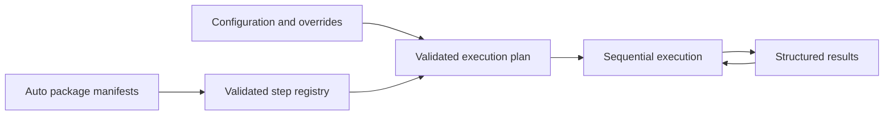

<!-- documentation-anchors:start -->
<a id="doc-plot-manager-runtime"></a>
<!-- documentation-anchors:end -->
# Plot Manager futtatókörnyezet

<!-- documentation-navigation -->
[English](plot-manager-runtime.md) | [Magyar](plot-manager-runtime-hu.md) · [Dokumentáció](README-hu.md) · [Projekt](../README-hu.md)
<!-- /documentation-navigation -->

A motor szakterülettől független. Az üzemeltetők választják ki a telepített csomagokat; a plotok konkrét hívásokat kapcsolnak össze; minden hívás a saját feloldott beállításait kapja meg.



<!-- documentation-anchors:start -->
<a id="doc-runtime-phases"></a>
<!-- documentation-anchors:end -->
## A futtatás fázisai

1. Jegyzékfájlok felderítése és a csomagazonosítók, lépésnevek, aliasok, sémák, függőségek és modulútvonalak ellenőrzése.
2. Csomagok importálása modulszintű hatókörökbe és az explicit exportált függvényeik feloldása.
3. Név szerinti plot feloldása, egyedi hívásazonosítók felépítése és a teljes statikus terv ellenőrzése.
4. A korábbi kimeneti hivatkozások feloldása közvetlenül az őket felhasználó lépés előtt.
5. Végrehajtás független beállításmásolattal és kis végrehajtási kontextussal.
6. Megállás az első hibánál, majd a futási/lépésállapotok és kimenetek visszaadása.

A kimeneti hivatkozások ellenőrzése nem ismerheti egy jövőbeli futásidejű érték alakját. Az előállító sikeres lehet, miközben a felhasználó lépés ellenőrzése mégis hibát jelez; az eredmény ezt a felhasználó hívást sikertelenként rögzíti. Nincs automatikus visszaállítás, újrapróbálás vagy párhuzamos végrehajtás.

A CLI az explicit alap-, projekt- és környezeti fájlokat ebben a sorrendben, mély összefésüléssel egyesíti. A `Read-PlotConfiguration -Path` a modul API-ján keresztül rendezett fájltömböt fogad; a `Merge-PlotSettings -Layers` memóriabeli objektumokat fésül össze. Az eredményül kapott konfiguráció adja a hívás paraméterrétegeinek alapját. Lásd a [konfigurációt](settings-hu.md).

<!-- documentation-anchors:start -->
<a id="doc-module-api"></a>
<!-- documentation-anchors:end -->
## Modul API

```powershell
Import-Module ./src/Deployment/Scripts/Core/PlotManager.psm1
$registry = New-PlotRegistry ./src/Deployment/Scripts/Auto
try {
    $configuration = Read-PlotConfiguration ./src/Deployment/Scripts/Examples/compose-files.json
    $result = Invoke-Plot -Registry $registry -Configuration $configuration -Plot compose-files -WorkDirectory ./plot-output
    if ($result.Status -eq 'Failed') { throw $result.Steps[-1].Error }
} finally {
    Remove-PlotRegistry $registry
}
```

Az előzetes ellenőrzési hibák lépések végrehajtása nélkül kivételt dobnak. A végrehajtási hibák strukturált Failed eredménnyé alakulnak. A CLI mindkét kategóriát 1-es kilépési kódra képezi. A WhatIf vagy az elutasított megerősítés eredménye Skipped. A natív csomagokhoz nincs szükség szkript-hatókörű Result értékre vagy módosítható globális konfigurációra.

<!-- documentation-anchors:start -->
<a id="doc-compatibility-boundary"></a>
<!-- documentation-anchors:end -->
## Kompatibilitási határ

A Run.ps1 -Legacy másik PowerShell-folyamatban indítja el a Run-Legacy.ps1 fájlt. Ott továbbra is elérhetők a történeti AutoExt fájlok, szkriptek és beállítások. Betöltésük előtt statikus Step-* ütközésellenőrzés fut.

A régi indító/leállító segédszkriptek most az önálló IIS csomagot hívják. Megtartják a pozicionális WebsiteName/AppPoolName paramétereket és a folyamat kilépési kódjait. Az IIS lekérdezése minden ciklusban újraolvassa az aktuális állapotot; indításkor előbb a készletre, majd a webhelyre vár, leállításkor előbb a webhelyre, majd a készletre. A hiányzó erőforrások és időtúllépések explicit hibát okoznak.

A régi backup-all szkript értelmezési hibái javításra kerültek. A legacy környezeti ráfedések már megkülönböztetik a hiányzó tulajdonságokat a false/zero értékektől, és nem írják ki a régi/új értékeket. A többi történeti szkript megtartja korábbi megvalósítását. Ez az átalakítás nem állítja róluk, hogy önállóan csomagoltak, teljes körűen teszteltek vagy általánosan hordozhatók.

A korábbi, nem összekapcsolt Core-Helpers.ps1/System-Steps.ps1 prototípusokat a motor és az IIS csomag váltotta fel; már nincsenek egymással versengő függvénydefiníciók.

A történeti GUI/HTTP-listener nem része ennek a futtatókörnyezetnek, és nem kapott modernizálást. Egy új helyi Windows Forms host és strukturált katalógus-/terv-/futtatási híd használja a natív motort; lásd a [helyi integrációt](local-integration-hu.md). A meglévő hívóintegrációknak az új CLI/API-szerződést kell választaniuk, vagy explicit legacy módot kell használniuk.

<!-- documentation-anchors:start -->
<a id="doc-validation"></a>
<!-- documentation-anchors:end -->
## Ellenőrzés

A tests alatti tesztcsomag lefedi a réteges CLI-fájlokat, a ZIP oda-vissza műveleteket, a könyvtárműveleteket, a JSON/XML-átalakításokat, a teljes réteges csomagpéldát, a valódi ideiglenes fájlok összekapcsolását, az ismételt hívásokat, a konfiguráció és a modulok elkülönítését, az ismétlődések elutasítását, a paraméter-/hivatkozás-ellenőrzést, a függőségi hibákat, a CLI-kilépési kódokat és az IIS-helyettesítőket. Az üzemeltetési tesztcsomag folyamatargumentum-/időtúllépés-ellenőrzésekkel, helyi HTTP/TCP-szerverekkel, valódi helyi Git repositorykkal és build/Docker adapterszerződés-tesztekkel egészíti ki ezt. Az alapértelmezett tesztcsomag az SQL/IIS/Compose providerszerződéseket és a helyi integrációs hidat is lefedi. Egy külön bekapcsolható, elkülönített SQL Server-/Compose-teszt valódi adatbázis-mentést/-visszaállítást és konténeréletciklus-ellenőrzéseket végez; lásd a [tesztelést](../tests/README-hu.md). A valódi IIS-telepítés és a vizuális GUI-átvétel továbbra is manuális. A Gitnek a PATH-on kell lennie.

Az új motorhoz és natív csomagjaihoz nem szükséges vállalati repositorykód vagy konfiguráció.
